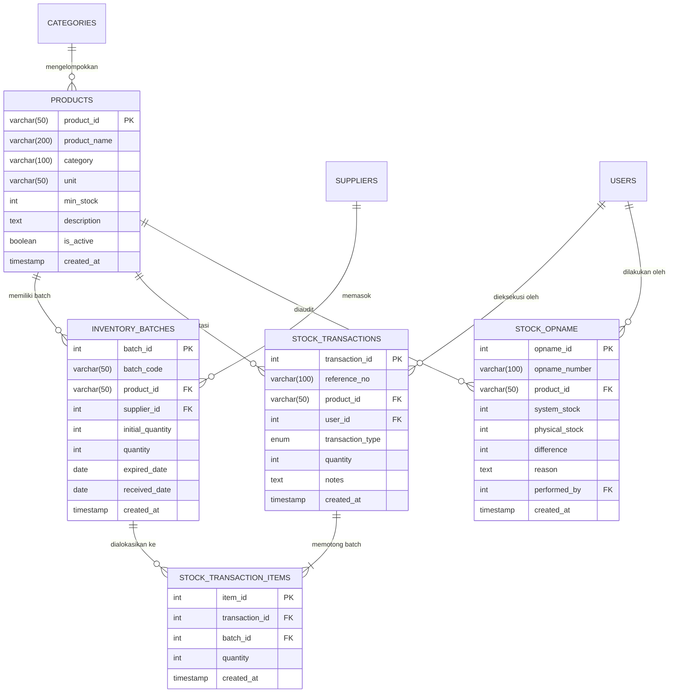

# 📦 SupplySync — Enterprise Mini Warehouse Management System (WMS)

> **High-Performance Mini WMS with Automated FEFO/FIFO Batch Allocation Engine, Real-Time Audit Trail Logging, and Physical Stock Opname Reconciliation.**


---

## 📄 Ringkasan Produk (Executive Summary)

Di industri pergudangan modern, rantai dingin (*cold chain*), dan agribisnis terintegrasi (seperti pakan ternak, unggas olahan, sembako, dan farmasi), pengelolaan stok bahan baku dan produk jadi yang memiliki umur simpan (*shelf-life*) terbatas membutuhkan presisi tinggi. Keterlambatan pengeluaran barang dapat mengakibatkan kerugian finansial akibat barang kedaluwarsa (*expired goods*).

**SupplySync** dibangun sebagai sistem manajemen pergudangan (*Warehouse Management System*) modern untuk menangani:
1. **Penelusuran Batch & Kedaluwarsa (*Expiry Date Tracking*)**: Pelacakan nomor batch, tanggal masuk, dan hitung mundur sisa hari menuju kedaluwarsa per SKU.
2. **Otomatisasi Alokasi FEFO (First-Expired, First-Out)**: Mengeluarkan batch yang paling mendekati tanggal kedaluwarsa terlebih dahulu dengan tiebreaker FIFO deterministik.
3. **Akuntabilitas Audit Trail & Batch Traceability**: Setiap mutasi stok dicatat dengan nomor referensi unik dan rincian alokasi batch yang terpotong.
4. **Rekonsiliasi Fisik (Stock Opname)**: Menyelaraskan selisih stok fisik aktual dengan stok sistem dan mencatat penyesuaian (*adjustment*) otomatis.

---

## ✨ Fitur-Fitur Utama yang Tersedia

| Fitur Utama | Fungsi & Deskripsi Teknis | Nilai Bisnis / Dampak |
|---|---|---|
| **Auto-FEFO Outflow Engine** | Mengurangi stok otomatis dari batch dengan tanggal kedaluwarsa paling dekat menggunakan transaksi atomik MySQL dan penguncian baris (`FOR UPDATE`). Mendukung tiebreaker penerimaan (*received_date*) dan perlindungan terhadap batch kedaluwarsa. | Mencegah kerugian barang busuk/kedaluwarsa di gudang (*zero expired waste*). |
| **Batch Traceability Per-Item** | Rincian pemotongan batch dicatat di tabel relasi `stock_transaction_items`, sehingga mutasi 100 unit yang memotong 3 batch berbeda tetap terlacak secara presisi. | Transparansi audit alur fisik barang dari penerimaan hingga pengiriman. |
| **Master Inventaris & Batch Breakdown** | Katalog SKU lengkap dengan indikator ambang batas aman (*Safe*, *Low Stock*, *Out of Stock*), filter kategori, pencarian real-time, dan modal rincian sub-batch per produk. | Memberikan visibilitas menyeluruh terhadap komposisi stok aktif. |
| **Multi-Batch Stock Inbound** | Pencatatan penerimaan barang fleksibel dengan kode batch, kuantitas, tanggal kedaluwarsa, dan identitas pemasok (*supplier*). | Menjamin akurasi histori kedatangan barang dari berbagai vendor. |
| **Modul Stock Disposal (Afkir)** | Pengeluaran barang rusak/kedaluwarsa dari stok aktif disertai alasan resmi (misal: kemasan bocor, lewat tanggal edar). | Memisahkan barang tidak layak jual dari inventaris komersial. |
| **Rekonsiliasi Stock Opname** | Modul pencatatan audit fisik gudang, menghitung deviasi surplus/defisit, dan mencatat transaksi tipe `ADJUSTMENT` secara otomatis. | Menjaga konsistensi data sistem dengan kondisi fisik rak gudang. |
| **Visual Analytics (Chart.js)** | Grafik perbandingan akumulasi volume barang masuk (*Inbound*) vs volume barang keluar (*FEFO Outflow / Disposal*). | Analisis tren pergantian stok (*inventory turnover*). |
| **Ekspor Laporan (CSV)** | Ekspor data Master Inventaris dan Audit Trail Log langsung ke file spreadsheet CSV. | Memudahkan rekonsiliasi dengan departemen Keuangan & Auditor Eksternal. |
| **UI/UX Modern & Aman** | Toast Notification interaktif, modal konfirmasi, penanganan responsif mobile/tablet, dan sanitasi pencegahan XSS (*Cross-Site Scripting*). | Pengalaman pengguna profesional, intuitif, dan aman digunakan di lantai gudang. |

---

## 🏗️ Arsitektur Sistem & Struktur Direktori

Aplikasi ini menggunakan pola arsitektur **Controller - Service - Repository (Layered Architecture)** yang memisahkan tanggung jawab logika bisnis, routing, validasi, dan persistensi database:

```text
SupplySync-Mini-Warehouse-Management-System/
│
├── database/
│   ├── schema.sql            # DDL MySQL 8.0, Relasi, Indeks Komposit, & Data Seeder
│   └── init.js               # Script runner inisialisasi / migrasi database otomatis
│
├── public/                   # FRONTEND (Single Page Application)
│   ├── css/
│   │   └── style.css         # Styling Enterprise, Glassmorphism, & Animasi Toast
│   ├── js/
│   │   ├── main.js           # Client Logic, Fetch API, XSS Escaping, Modal, Toast, & Chart
│   │   └── dashboard.js      # Pintasan Keyboard (Ctrl+K untuk pencarian cepat)
│   └── index.html            # Layout Dashboard Enterprise & Modals
│
├── src/                      # BACKEND (Express.js RESTful API)
│   ├── config/
│   │   └── database.js       # MySQL Connection Pool & Promise Handler (Aman dari hardcoded credentials)
│   ├── controllers/
│   │   ├── productController.js   # Controller SKU, Master Data, & Batch Priorities
│   │   ├── stockController.js     # Controller Inbound, FEFO Outflow, Disposal, & Audit
│   │   ├── supplierController.js  # Controller Pemasok / Vendor
│   │   └── categoryController.js  # Controller Kategori Produk
│   ├── middlewares/
│   │   ├── validator.js           # Validasi ketat input angka bulat, format tanggal, & sanitasi teks
│   │   └── errorHandler.js        # Centralized Error Handling & JSON 404 Handler
│   ├── services/
│   │   └── inventoryService.js    # Core Engine: FEFO Allocation Algorithm & Row Locking
│   └── routes/
│       └── api.js                 # REST API Endpoints Router
│
├── tests/                    # AUTOMATED TESTING SUITE
│   ├── fefoEngine.test.js    # Unit test algoritma FEFO & tiebreaker deterministik
│   ├── validator.test.js     # Unit test validasi input & boundary values
│   ├── referenceNumber.test.js # Unit test generator nomor transaksi
│   └── app.test.js           # Integration test security headers, routing 404, & Express app
│
├── .env.example              # Template variabel lingkungan yang aman
├── .gitignore                # Aturan pengabaian node_modules, rahasia .env, logs
├── app.js                    # Server Entry Point & Express Application Server
├── package.json              # Dependensi proyek & npm scripts
└── README.md                 # Dokumentasi sistem & panduan operasional
```

---

## 🗄️ Skema Database & Relasi (DDL)

Database menggunakan **MySQL 8.0+** dengan storage engine **InnoDB** untuk mendukung transaksi ACID penuh (*Atomicity, Consistency, Isolation, Durability*):



### Indeks Kinerja FEFO
Untuk memastikan performa kueri tetap cepat saat melayani ribuan batch:
```sql
INDEX `idx_batch_fefo` (`product_id`, `quantity`, `expired_date`, `received_date`, `batch_id`)
```
Indeks komposit ini memungkinkan mesin MySQL mengambil batch aktif terurut tanpa memerlukan filesort tambahan di disk.

---

## ⚙️ Logika Bisnis FEFO vs FIFO

### Perbedaan FEFO dan FIFO:
- **FIFO (First-In, First-Out)**: Mengeluarkan barang berdasarkan urutan kedatangan pertama (`received_date ASC`).
- **FEFO (First-Expired, First-Out)**: Mengeluarkan barang berdasarkan tanggal kedaluwarsa paling dekat (`expired_date ASC`).

Pada produk dengan masa simpan terbatas, **FEFO** adalah standar industri wajib. SupplySync mengimplementasikan alokasi FEFO dengan aturan:
1. **Prioritas Utama**: Batch dengan `expired_date` paling dekat.
2. **Tiebreaker 1**: Jika dua batch memiliki tanggal kedaluwarsa yang sama, alokasikan batch yang tiba lebih dulu (`received_date ASC`).
3. **Tiebreaker 2**: Jika tanggal masuk sama, alokasikan berdasarkan `batch_id ASC`.
4. **Perlindungan Barang Kedaluwarsa**: Secara default, pengeluaran komersial (`OUT`) menolak mengalokasikan batch yang sudah melewati hari ini (`expired_date < CURDATE()`), mengarahkan operator menggunakan modul **Disposal (Afkir)**.
5. **Pencegahan Concurrency Deadlock**: Transaksi mengunci baris master produk terlebih dahulu (`SELECT ... FROM products WHERE product_id = ? FOR UPDATE`) sebelum mengunci batch terkait, menjamin serialisasi transaksi yang aman dan bebas *race condition*.

---

## 🚀 Panduan Instalasi & Menjalankan Aplikasi

### 1. Prasyarat Sistem
- **Node.js**: Versi 18.x atau yang lebih baru (Disarankan Node.js v20 / v24).
- **MySQL Server**: Versi 8.0+.
- **Git**.

### 2. Kloning Repositori & Instal Dependensi
```bash
git clone https://github.com/ChoqySirait/SupplySync-Mini-Warehouse-Management-System.git
cd SupplySync-Mini-Warehouse-Management-System
npm install
```

### 3. Konfigurasi Lingkungan (`.env`)
Salin file `.env.example` menjadi `.env` dan sesuaikan kredensial MySQL lokal Anda:
```bash
cp .env.example .env
```
Isi konfigurasi pada file `.env`:
```env
PORT=5000
NODE_ENV=development

DB_HOST=localhost
DB_PORT=3306
DB_USER=root
DB_PASSWORD=password_mysql_anda
DB_NAME=supplysync_db
```

### 4. Inisialisasi Database & Seeder Data
Jalankan perintah berikut untuk membuat database `supplysync_db`, membuat tabel DDL lengkap, dan mengisi data awal siap uji:
```bash
npm run db:init
```

### 5. Menjalankan Server
Mode produksi:
```bash
npm start
```
Mode pengembangan (*auto-reload* dengan nodemon):
```bash
npm run dev
```
Akses aplikasi melalui browser di: `http://localhost:5000`

---

## 🧪 Pengujian Otomatis (*Automated Testing*)

Proyek ini dilengkapi dengan rangkaian pengujian otomatis berbasis Node.js Native Test Runner (`node --test`), tanpa ketergantungan pihak ketiga yang berat:

Jalankan test suite:
```bash
npm test
```

### Cakupan Pengujian (28 Tests):
- **Logika FEFO Engine (8 tests)**: Single batch partial deduction, exact match, multi-batch depletion, tiebreaker FIFO, tiebreaker ID, insufficient stock, penanganan batch 0, edge cases.
- **Middleware Input Validator (12 tests)**: Validasi SKU, nama produk, batas stok minimum, validasi bilangan bulat positif, format tanggal ISO, alasan afkir, stock opname.
- **Generator Nomor Referensi (4 tests)**: Pola referensi unik transaksi `TRX-IN-...`, `TRX-OUT-...`, `TRX-DISP-...`.
- **Integrasi Express & Keamanan (4 tests)**: Pemeriksaan header keamanan (`X-Content-Type-Options`, `X-Frame-Options`, `X-XSS-Protection`), response JSON 404, dan penolakan payload tidak valid.

Hasil eksekusi:
```text
✔ Express In-Memory Routing & Security Tests (4 pass)
✔ FEFO Engine Allocation Logic (8 pass)
✔ WMS Reference Number Generator Tests (4 pass)
✔ Middleware Input Validator Tests (12 pass)
ℹ tests 28 | suites 9 | pass 28 | fail 0
```

---

## 🔌 Dokumentasi REST API

| Method | Endpoint | Deskripsi | Status Sukses |
|---|---|---|:---:|
| `GET` | `/api/products` | Ambil semua produk, total stok, dan status ambang batas | `200 OK` |
| `POST` | `/api/products` | Daftarkan master SKU baru | `201 Created` |
| `PUT` | `/api/products/:id` | Perbarui data produk | `200 OK` |
| `DELETE` | `/api/products/:id` | Nonaktifkan produk (hanya jika total stok 0) | `200 OK` |
| `GET` | `/api/products/:id/batches` | Ambil rincian seluruh batch aktif milik produk | `200 OK` |
| `GET` | `/api/batches/fefo` | Ambil batch terurut FEFO (paling dekat kedaluwarsa) | `200 OK` |
| `POST` | `/api/stock/in` | Penerimaan barang masuk (*Inbound*) | `201 Created` |
| `POST` | `/api/stock/out` | Pengeluaran barang otomatis FEFO (*Outflow*) | `200 OK` |
| `POST` | `/api/stock/disposal` | Pembuangan barang afkir/rusak/kedaluwarsa | `200 OK` |
| `POST` | `/api/stock/opname` | Eksekusi rekonsiliasi stock opname fisik | `200 OK` |
| `GET` | `/api/stock/opname` | Ambil riwayat audit stock opname | `200 OK` |
| `GET` | `/api/transactions` | Ambil riwayat audit trail (filter tipe & pagination) | `200 OK` |
| `GET` | `/api/categories` | Ambil daftar kategori produk | `200 OK` |
| `POST` | `/api/categories` | Tambah kategori produk baru | `201 Created` |
| `GET` | `/api/suppliers` | Ambil daftar pemasok aktif | `200 OK` |
| `POST` | `/api/suppliers` | Daftarkan pemasok baru | `201 Created` |

---

## 🔒 Keamanan & Praktik Terbaik yang Diterapkan

1. **Pencegahan Kredensial Bocor**: `.env` dan `node_modules` telah dihapus dari pelacakan Git, dilengkapi `.env.example` dan `.gitignore` komprehensif.
2. **Pencegahan SQL Injection**: Seluruh kueri MySQL menggunakan *Parameterized Prepared Statements* (`?`).
3. **Pencegahan XSS (Cross-Site Scripting)**: Seluruh output dinamis pada antarmuka frontend melalui fungsi `escapeHtml()`.
4. **Header Keamanan HTTP**: Perlindungan bawaan terhadap clickjacking (`X-Frame-Options: DENY`) dan MIME sniffing (`X-Content-Type-Options: nosniff`).
5. **Integritas Database**: Penggunaan Foreign Keys dengan constraint `ON DELETE RESTRICT` dan check constraint `quantity >= 0` untuk mencegah stok negatif.

---

## 📌 Batasan Saat Ini & Roadmap Pengembangan Lanjutan

### Batasan Saat Ini:
- Autentikasi sesi JWT/OAuth pengguna belum diaktifkan pada antarmuka web (saat ini transaksi menggunakan identitas operator default sistem).
- Manajemen multi-gudang (*multi-warehouse / bin location mapping*) belum diimplementasikan.

### Roadmap Selanjutnya:
- [ ] Implementasi login autentikasi JWT dan Role-Based Access Control (RBAC) pada frontend.
- [ ] Modul Manajemen Lokasi Rak & Zona Gudang (Aisle/Rack/Bin).
- [ ] Fitur Barcode / QR Code Scanner untuk mempermudah stock opname fisik melalui perangkat mobile.
- [ ] Cetak Dokumen Surat Jalan (*Delivery Order*) dan Bukti Penerimaan Barang (*Goods Receipt Note*) format PDF.

---

## 📄 Lisensi

Proyek ini dirilis di bawah lisensi [MIT](LICENSE). Dikembangkan oleh Tim Engineering SupplySync untuk kebutuhan manajemen inventaris pergudangan modern.
