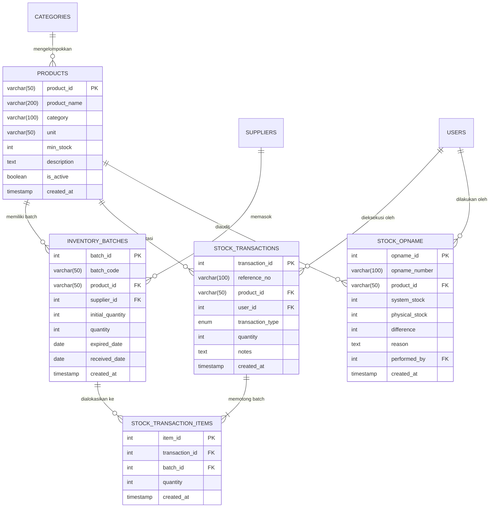

# 📦 SupplySync — Enterprise Mini Warehouse Management System (WMS)

> **High-Performance Mini WMS with Automated FEFO/FIFO Batch Allocation Engine, Real-Time Audit Trail Logging, and Physical Stock Opname Reconciliation.**


---

## 📄 Ringkasan Produk (Executive Summary)

Di industri pergudangan modern, rantai dingin (*cold chain*), dan agribisnis terintegrasi (seperti pakan ternak, unggas olahan, sembako, dan farmasi), pengelolaan stok bahan baku dan produk jadi yang memiliki umur simpan (*shelf-life*) terbatas membutuhkan presisi tinggi. Keterlambatan pengeluaran barang dapat mengakibatkan kerugian finansial akibat barang kedaluwarsa (*expired goods*).

**SupplySync** dibangun sebagai sistem manajemen pergudangan (*Warehouse Management System*) modern untuk menangani:
1. **Penelusuran Batch & Kedaluwarsa (*Expiry Date Tracking*)**: Pelacakan nomor batch, tanggal masuk, dan hitung mundur sisa hari menuju kedaluwarsa per SKU.
2. **Otomatisasi Alokasi FEFO (First-Expired, First-Out)**: Mengeluarkan batch yang paling mendekati tanggal kedaluwarsa terlebih dahulu dengan tiebreaker FIFO deterministik.
3. **Akuntabilitas Audit Trail & Batch Traceability**: Setiap mutasi stok dicatat dengan nomor referensi unik dan rincian alokasi batch yang terpotong.
4. **Rekonsiliasi Fisik (Stock Opname)**: Menyelaraskan selisih stok fisik aktual dengan stok sistem dan mencatat penyesuaian (*adjustment*) otomatis.

---

## ✨ Fitur-Fitur Utama yang Tersedia

| Fitur Utama | Fungsi & Deskripsi Teknis | Nilai Bisnis / Dampak |
|---|---|---|
| **Auto-FEFO Outflow Engine** | Mengurangi stok otomatis dari batch dengan tanggal kedaluwarsa paling dekat menggunakan transaksi atomik MySQL dan penguncian baris (`FOR UPDATE`). Mendukung tiebreaker penerimaan (*received_date*) dan perlindungan terhadap batch kedaluwarsa. | Mencegah kerugian barang busuk/kedaluwarsa di gudang (*zero expired waste*). |
| **Warehouse Bin/Rack Location & Picking Slip** | Setiap batch ditempatkan pada koordinat fisik gudang (*Zone, Aisle, Rack, Tier, Bin*). Saat barang keluar, sistem menerbitkan **Digital Picking Route Slip** yang dapat dicetak langsung. | Mempercepat waktu pemetikan barang (*picking speed*) dan mencegah salah ambil lokasi. |
| **Valuasi Aset Inventaris & Eksekutif KPI** | Perhitungan otomatis total nilai valuasi aset stok gudang ($\sum \text{stok} \times \text{HPP}$), *Freshness Health Score* batch (rasio segar vs expired), dan pelacakan produk *Fast-Moving*. | Visibilitas finansial dan kesehatan stok waktu-nyata bagi manajemen pergudangan. |
| **Kartu Stok Persediaan (Stock Card Ledger)** | Laporan kronologis mutasi debit/kredit per SKU dengan saldo awal (*beginning balance*), mutasi masuk, mutasi keluar, penyesuaian opname, dan saldo berjalan (*running balance*). Dilengkapi cetak dokumen fisik format A4 dan ekspor spreadsheet CSV (Excel-ready). | Instrumen audit inventaris utama untuk rekonsiliasi berkala dan pemeriksaan auditor eksternal. |
| **Audit Integritas Data & Snapshot Backup** | Layanan diagnostik konsistensi saldo master produk vs total batch, deteksi anomali kuantitas negatif, batch yatim, serta pencadangan snapshot otomatis JSON & SQL dump via CLI (`npm run db:backup`, `npm run db:verify`) maupun UI web. | Menjamin keandalan data pergudangan, integritas referensial 100%, serta kepatuhan pemulihan bencana (*Disaster Recovery*). |
| **Bulk CSV Importer (SKU & Inbound Manifest)** | Impor massal ratusan master SKU dan manifest penerimaan barang via file spreadsheet CSV dengan parser RFC 4180 mandiri, preview interaktif, dan transaksi atomik MySQL. | Menghemat waktu onboarding dan entri data pasokan secara masif (*high operational velocity*). |
| **Dokumen Logistik Resmi (GRN & DO)** | Penerbitan otomatis **Bukti Penerimaan Barang (*Goods Receipt Note*)** dan **Surat Jalan Pengiriman (*Delivery Order*)** siap cetak A4 lengkap dengan barcode Code 39 dan 3 kolom tanda tangan resmi. | Keabsahan legal dan akuntabilitas serah terima barang antar pihak ekspedisi, gudang, dan pelanggan. |
| **Barcode Generator & Cetak Stiker Termal** | Mesin pembuat barcode vektor SVG mandiri (Code 39) untuk pencetakan label stiker rak (*Bin Location Tag*) dan stiker SKU produk tanpa dependensi eksternal. Mendukung *keyboard scanner* fisik. | Mempercepat identifikasi fisik barang di rak dan otomatisasi pemindaian di lantai gudang. |
| **Autentikasi & RBAC (Role-Based Access Control)** | Sistem login berbasis token JWT (HMAC-SHA256) dengan pembagian peran (`ADMIN`, `MANAGER`, `STAFF`) dan hashing kata sandi aman (`crypto.scrypt`). | Menjamin kontrol akses terotorisasi dan akuntabilitas operator pada audit trail. |
| **Batch Traceability Per-Item** | Rincian pemotongan batch dicatat di tabel relasi `stock_transaction_items`, sehingga mutasi 100 unit yang memotong 3 batch berbeda tetap terlacak secara presisi. | Transparansi audit alur fisik barang dari penerimaan hingga pengiriman. |
| **Master Inventaris & Batch Breakdown** | Katalog SKU lengkap dengan indikator ambang batas aman (*Safe*, *Low Stock*, *Out of Stock*), filter kategori, pencarian real-time, dan modal rincian sub-batch per produk. | Memberikan visibilitas menyeluruh terhadap komposisi stok aktif. |
| **Multi-Batch Stock Inbound** | Pencatatan penerimaan barang fleksibel dengan kode batch, kuantitas, tanggal kedaluwarsa, pemilihan lokasi rak, dan identitas pemasok (*supplier*). | Menjamin akurasi histori kedatangan barang dari berbagai vendor. |
| **Modul Stock Disposal (Afkir)** | Pengeluaran barang rusak/kedaluwarsa dari stok aktif disertai alasan resmi (misal: kemasan bocor, lewat tanggal edar). | Memisahkan barang tidak layak jual dari inventaris komersial. |
| **Rekonsiliasi Stock Opname** | Modul pencatatan audit fisik gudang, menghitung deviasi surplus/defisit, dan mencatat transaksi tipe `ADJUSTMENT` secara otomatis. | Menjaga konsistensi data sistem dengan kondisi fisik rak gudang. |
| **Visual Analytics (Chart.js)** | Grafik perbandingan akumulasi volume barang masuk (*Inbound*) vs volume barang keluar (*FEFO Outflow / Disposal*). | Analisis tren pergantian stok (*inventory turnover*). |
| **Ekspor Laporan (CSV)** | Ekspor data Master Inventaris dan Audit Trail Log langsung ke file spreadsheet CSV. | Memudahkan rekonsiliasi dengan departemen Keuangan & Auditor Eksternal. |
| **UI/UX Modern & Aman** | Toast Notification interaktif, modal konfirmasi, penanganan responsif mobile/tablet, dan sanitasi pencegahan XSS (*Cross-Site Scripting*). | Pengalaman pengguna profesional, intuitif, dan aman digunakan di lantai gudang. |

---

## 🏗️ Arsitektur Sistem & Struktur Direktori

Aplikasi ini menggunakan pola arsitektur **Controller - Service - Repository (Layered Architecture)** yang memisahkan tanggung jawab logika bisnis, routing, validasi, dan persistensi database:

```text
SupplySync-Mini-Warehouse-Management-System/
│
├── database/
│   ├── schema.sql            # DDL MySQL 8.0, Relasi, Indeks Komposit, & Data Seeder
│   └── init.js               # Script runner inisialisasi / migrasi database otomatis
│
├── scripts/
│   └── dbBackup.js           # CLI Runner cadangan database & audit integritas data (npm run db:backup / db:verify)
│
├── public/                   # FRONTEND (Single Page Application)
│   ├── css/
│   │   └── style.css         # Styling Enterprise, Glassmorphism, & Animasi Toast
│   ├── js/
│   │   ├── main.js           # Client Logic, Fetch API, XSS Escaping, Modal, Toast, & Chart
│   │   ├── barcode.js        # SVG Barcode Generator (Code 39) & Label Cetak Stiker Gudang
│   │   ├── documents.js      # Generator Bukti Penerimaan Barang (GRN) & Surat Jalan (DO)
│   │   └── dashboard.js      # Pintasan Keyboard (Ctrl+K untuk pencarian cepat)
│   └── index.html            # Layout Dashboard Enterprise & Modals
│
├── src/                      # BACKEND (Express.js RESTful API)
│   ├── config/
│   │   └── database.js       # MySQL Connection Pool & Promise Handler (Aman dari hardcoded credentials)
│   ├── controllers/
│   │   ├── authController.js      # Controller Autentikasi JWT & Pengguna
│   │   ├── analyticsController.js # Controller Valuasi Aset Inventaris & KPI Kesegaran
│   │   ├── reportController.js    # Controller Laporan Kartu Stok & Ekspor CSV Spreadsheet
│   │   ├── systemController.js    # Controller Diagnostik Integritas Data & Cadangan Database
│   │   ├── locationController.js  # Controller Manajemen Rak & Bin Gudang
│   │   ├── productController.js   # Controller SKU, Master Data, & Batch Priorities
│   │   ├── stockController.js     # Controller Inbound, FEFO Outflow, Disposal, & Audit
│   │   ├── supplierController.js  # Controller Pemasok / Vendor
│   │   └── categoryController.js  # Controller Kategori Produk
│   ├── middlewares/
│   │   ├── authMiddleware.js      # Middleware Autentikasi Token JWT & Otorisasi RBAC
│   │   ├── validator.js           # Validasi ketat input angka bulat, format tanggal, & sanitasi teks
│   │   └── errorHandler.js        # Centralized Error Handling & JSON 404 Handler
│   ├── services/
│   │   └── inventoryService.js    # Core Engine: FEFO Allocation Algorithm & Row Locking
│   ├── utils/
│   │   ├── backupService.js       # Layanan Evaluasi Integritas Data, Snapshot JSON, & Dump SQL
│   │   ├── csvParser.js           # RFC 4180 Compliant CSV Parser & Serializer mandiri
│   │   └── security.js            # Standalone JWT Sign/Verify & Scrypt Password Hasher
│   └── routes/
│       └── api.js                 # REST API Endpoints Router
│
├── tests/                    # AUTOMATED TESTING SUITE (68 Tests / 18 Suites)
│   ├── fefoEngine.test.js    # Unit test algoritma FEFO & tiebreaker deterministik
│   ├── location.test.js      # Unit test alokasi rak & digital picking slip
│   ├── auth.test.js          # Unit test RBAC authorization & auth middleware
│   ├── security.test.js      # Unit test scrypt password hashing & JWT token validation
│   ├── analytics.test.js     # Unit test formula valuasi aset stok & health score
│   ├── backup.test.js        # Unit test audit integritas referensial data & generator SQL dump
│   ├── barcode.test.js       # Unit test SVG barcode generator & sanitasi input
│   ├── csvParser.test.js     # Unit test parser RFC 4180 CSV & handling quoted text
│   ├── import.test.js        # Unit test validasi manifest inbound & bulk import logic
│   ├── stockLedger.test.js   # Unit test kartu stok & perhitungan saldo berjalan
│   ├── validator.test.js     # Unit test validasi input & boundary values
│   ├── referenceNumber.test.js # Unit test generator nomor transaksi
│   └── app.test.js           # Integration test security headers, routing 404, & Express app
│
├── .env.example              # Template variabel lingkungan yang aman
├── .gitignore                # Aturan pengabaian node_modules, rahasia .env, logs
├── app.js                    # Server Entry Point & Express Application Server
├── package.json              # Dependensi proyek & npm scripts
└── README.md                 # Dokumentasi sistem & panduan operasional
```

---

## 🗄️ Skema Database & Relasi (DDL)

Database menggunakan **MySQL 8.0+** dengan storage engine **InnoDB** untuk mendukung transaksi ACID penuh (*Atomicity, Consistency, Isolation, Durability*):



### Indeks Kinerja FEFO
Untuk memastikan performa kueri tetap cepat saat melayani ribuan batch:
```sql
INDEX `idx_batch_fefo` (`product_id`, `quantity`, `expired_date`, `received_date`, `batch_id`)
```
Indeks komposit ini memungkinkan mesin MySQL mengambil batch aktif terurut tanpa memerlukan filesort tambahan di disk.

---

## ⚙️ Logika Bisnis FEFO vs FIFO

### Perbedaan FEFO dan FIFO:
- **FIFO (First-In, First-Out)**: Mengeluarkan barang berdasarkan urutan kedatangan pertama (`received_date ASC`).
- **FEFO (First-Expired, First-Out)**: Mengeluarkan barang berdasarkan tanggal kedaluwarsa paling dekat (`expired_date ASC`).

Pada produk dengan masa simpan terbatas, **FEFO** adalah standar industri wajib. SupplySync mengimplementasikan alokasi FEFO dengan aturan:
1. **Prioritas Utama**: Batch dengan `expired_date` paling dekat.
2. **Tiebreaker 1**: Jika dua batch memiliki tanggal kedaluwarsa yang sama, alokasikan batch yang tiba lebih dulu (`received_date ASC`).
3. **Tiebreaker 2**: Jika tanggal masuk sama, alokasikan berdasarkan `batch_id ASC`.
4. **Perlindungan Barang Kedaluwarsa**: Secara default, pengeluaran komersial (`OUT`) menolak mengalokasikan batch yang sudah melewati hari ini (`expired_date < CURDATE()`), mengarahkan operator menggunakan modul **Disposal (Afkir)**.
5. **Pencegahan Concurrency Deadlock**: Transaksi mengunci baris master produk terlebih dahulu (`SELECT ... FROM products WHERE product_id = ? FOR UPDATE`) sebelum mengunci batch terkait, menjamin serialisasi transaksi yang aman dan bebas *race condition*.

---

## 🚀 Panduan Instalasi & Menjalankan Aplikasi

### 1. Prasyarat Sistem
- **Node.js**: Versi 18.x atau yang lebih baru (Disarankan Node.js v20 / v24).
- **MySQL Server**: Versi 8.0+.
- **Git**.

### 2. Kloning Repositori & Instal Dependensi
```bash
git clone https://github.com/ChoqySirait/SupplySync-Mini-Warehouse-Management-System.git
cd SupplySync-Mini-Warehouse-Management-System
npm install
```

### 3. Konfigurasi Lingkungan (`.env`)
Salin file `.env.example` menjadi `.env` dan sesuaikan kredensial MySQL lokal Anda:
```bash
cp .env.example .env
```
Isi konfigurasi pada file `.env`:
```env
PORT=5000
NODE_ENV=development

DB_HOST=localhost
DB_PORT=3306
DB_USER=root
DB_PASSWORD=password_mysql_anda
DB_NAME=supplysync_db
```

### 4. Inisialisasi Database & Seeder Data
Jalankan perintah berikut untuk membuat database `supplysync_db`, membuat tabel DDL lengkap, dan mengisi data awal siap uji:
```bash
npm run db:init
```

### 5. Menjalankan Server
Mode produksi:
```bash
npm start
```
Mode pengembangan (*auto-reload* dengan nodemon):
```bash
npm run dev
```
Akses aplikasi melalui browser di: `http://localhost:5000`

---

## 🧪 Pengujian Otomatis (*Automated Testing*)

Proyek ini dilengkapi dengan rangkaian pengujian otomatis berbasis Node.js Native Test Runner (`node --test`), tanpa ketergantungan pihak ketiga yang berat:

Jalankan test suite:
```bash
npm test
```

### Cakupan Pengujian (39 Tests):
- **Keamanan & Autentikasi JWT / scrypt (5 tests)**: Password hashing NIST-compliant, verifikasi akun demo, penandatanganan HMAC-SHA256, deteksi tamper, verifikasi masa kedaluwarsa.
- **Middleware Autentikasi & RBAC (4 tests)**: Validasi Bearer token, penolakan token absen/invalid, otorisasi role ADMIN vs STAFF.
- **Logika FEFO Engine (8 tests)**: Single batch partial deduction, exact match, multi-batch depletion, tiebreaker FIFO, tiebreaker ID, insufficient stock, penanganan batch 0, edge cases.
- **Alokasi Lokasi Rak & Rute Petik / Picking Slip (2 tests)**: Penentuan koordinat rak lorong dan alokasi multi-lokasi.
- **Generator Nomor Referensi (4 tests)**: Pola referensi unik transaksi `TRX-IN-...`, `TRX-OUT-...`, `TRX-DISP-...`.
- **Middleware Input Validator (12 tests)**: Validasi SKU, nama produk, batas stok minimum, validasi bilangan bulat positif, format tanggal ISO, alasan afkir, stock opname.
- **Parser RFC 4180 CSV & Serializer (5 tests)**: Parsing field berkoma, tanda kutip ganda ter-escape (`""`), line break CRLF/LF, serialisasi objek ke teks CSV, dan penanganan input kosong.
- **Logika Validasi Bulk CSV Importer (4 tests)**: Pemetaan fleksibel nama kolom header CSV, validasi integritas kuantitas manifest inbound, deteksi baris tidak valid, dan sanitasi spasi ekstra.
- **Valuasi Inventaris & Formula Health Score (3 tests)**: Verifikasi ketepatan formula kalkulasi valuasi aset dan persentase skor kesegaran stok batch.
- **Generator SVG Barcode & Label Termal (5 tests)**: Verifikasi encoding pola Code 39 standar, pembentukan elemen vektor `<svg>`, sanitasi karakter ilegal, dan opsi styling.
- **Kartu Stok & Perhitungan Saldo Berjalan (4 tests)**: Verifikasi saldo awal, mutasi debit/kredit, penyesuaian opname surplus/defisit, dan integritas saldo akhir.
- **Integrasi Express & Keamanan (4 tests)**: Pemeriksaan header keamanan (`X-Content-Type-Options`, `X-Frame-Options`, `X-XSS-Protection`), response JSON 404, dan penolakan payload tidak valid.

Hasil eksekusi:
```text
✔ Warehouse KPI & Inventory Valuation Analytics Tests (3 pass)
✔ Express In-Memory Routing & Security Tests (Zero Network Sockets) (4 pass)
✔ Auth Middleware & RBAC Tests (4 pass)
✔ Code 39 SVG Barcode & Thermal Label Generator Tests (5 pass)
✔ RFC 4180 CSV Parser & Serializer Tests (5 pass)
✔ FEFO Engine Allocation Logic (8 pass)
✔ WMS Bulk CSV Import Business Logic Tests (4 pass)
✔ Warehouse Bin Location & Picking Route Allocation Tests (2 pass)
✔ WMS Reference Number Generator Tests (4 pass)
✔ Security Utilities: Password Hashing & JWT (5 pass)
✔ WMS Stock Card Ledger & Running Balance Tests (4 pass)
✔ Database Integrity Verification & Backup Utilities Tests (7 pass)
✔ Middleware Input Validator Tests (12 pass)
ℹ tests 68 | suites 18 | pass 68 | fail 0
```

---

## 🔌 Dokumentasi REST API

| Method | Endpoint | Deskripsi | Otorisasi / Role |
|---|---|---|:---:|
| `POST` | `/api/auth/login` | Login operator dan terbitkan JWT Token (24 jam) | Public |
| `GET` | `/api/auth/me` | Ambil profil operator aktif dari Bearer Token | Authenticated |
| `GET` | `/api/auth/users` | Ambil daftar pengguna & operator gudang | Public / Admin |
| `GET` | `/api/analytics/kpi` | Ambil valuasi aset total, health score kesegaran, & fast-moving items | Public |
| `GET` | `/api/reports/stock-card` | Ambil laporan kartu stok, saldo awal, mutasi, & saldo berjalan (`?format=csv` untuk spreadsheet) | Public |
| `GET` | `/api/system/health-check` | Audit integritas referensial data, status konsistensi stok master vs batch | Public / Authenticated |
| `POST` | `/api/system/backup` | Trigger pencadangan database snapshot (JSON & SQL Dump) ke folder `/backups` | Authenticated / Admin |
| `GET` | `/api/system/backups` | Ambil daftar riwayat berkas cadangan database yang tersimpan | Authenticated |
| `GET` | `/api/system/backups/:filename` | Unduh berkas cadangan snapshot spesifik (terproteksi dari path traversal) | Authenticated |
| `GET` | `/api/products` | Ambil semua produk, total stok, HPP, dan status ambang batas | Public |
| `POST` | `/api/products` | Daftarkan master SKU baru (beserta HPP) | Authenticated |
| `POST` | `/api/products/import-csv` | Impor massal master SKU produk dari teks/file CSV | Authenticated |
| `PUT` | `/api/products/:id` | Perbarui data produk | Authenticated |
| `DELETE` | `/api/products/:id` | Nonaktifkan produk (hanya jika total stok 0) | `ADMIN` Only |
| `GET` | `/api/products/:id/batches` | Ambil rincian batch aktif dan lokasi rak per SKU | Public |
| `GET` | `/api/batches/fefo` | Ambil batch terurut FEFO (paling dekat kedaluwarsa) | Public |
| `POST` | `/api/stock/in` | Penerimaan barang masuk (*Inbound*) beserta lokasi rak | Authenticated |
| `POST` | `/api/stock/in/import-csv` | Impor massal manifest penerimaan barang via CSV | Authenticated |
| `POST` | `/api/stock/out` | Pengeluaran otomatis FEFO & penerbitan Picking Slip | Authenticated |
| `POST` | `/api/stock/disposal` | Pembuangan barang afkir/rusak/kedaluwarsa | Authenticated |
| `POST` | `/api/stock/opname` | Eksekusi rekonsiliasi stock opname fisik | Authenticated |
| `GET` | `/api/stock/opname` | Ambil riwayat audit stock opname | Public |
| `GET` | `/api/transactions` | Ambil riwayat audit trail (filter tipe & pagination) | Public |
| `GET` | `/api/locations` | Ambil seluruh lokasi rak dan kapasitas bin gudang | Public |
| `POST` | `/api/locations` | Tambah lokasi rak/bin gudang baru | Authenticated |
| `GET` | `/api/categories` | Ambil daftar kategori produk | Public |
| `POST` | `/api/categories` | Tambah kategori produk baru | Authenticated |
| `GET` | `/api/suppliers` | Ambil daftar pemasok aktif | Public |
| `POST` | `/api/suppliers` | Daftarkan pemasok baru | Authenticated |

---

## 🔒 Keamanan & Praktik Terbaik yang Diterapkan

1. **Pencegahan Kredensial Bocor**: `.env` dan `node_modules` telah dihapus dari pelacakan Git, dilengkapi `.env.example` dan `.gitignore` komprehensif.
2. **Pencegahan SQL Injection**: Seluruh kueri MySQL menggunakan *Parameterized Prepared Statements* (`?`).
3. **Pencegahan XSS (Cross-Site Scripting)**: Seluruh output dinamis pada antarmuka frontend melalui fungsi `escapeHtml()`.
4. **Header Keamanan HTTP**: Perlindungan bawaan terhadap clickjacking (`X-Frame-Options: DENY`) dan MIME sniffing (`X-Content-Type-Options: nosniff`).
5. **Integritas Database**: Penggunaan Foreign Keys dengan constraint `ON DELETE RESTRICT` dan check constraint `quantity >= 0` untuk mencegah stok negatif.

---

## 📌 Roadmap & Capaian Pengembangan

### ✅ Telah Diselesaikan:
- [x] Mesin Alokasi FEFO Deterministic dengan penguncian baris (`FOR UPDATE`) dan tiebreaker FIFO.
- [x] Traceability Batch Per-Item (`stock_transaction_items`) dan Audit Trail Lengkap.
- [x] Manajemen Lokasi Rak Gudang (Zone, Aisle, Rack, Tier, Bin) & Digital Picking Slip.
- [x] Autentikasi JWT (HMAC-SHA256) & Scrypt Password Hashing dengan Role-Based Access Control (RBAC).
- [x] Modul Rekonsiliasi Fisik Stock Opname & Penyesuaian Otomatis.
- [x] Valuasi Aset Stok Inventaris & Metrik KPI Kesegaran Batch (*Freshness Health Score*).
- [x] Generator Barcode Vektor SVG (Code 39) & Cetak Label Stiker Termal (Rak & SKU).
- [x] Modul Bulk CSV Importer (Master SKU & Manifest Inbound Pasokan) dengan parser RFC 4180 mandiri.
- [x] Dokumen Logistik Resmi: Bukti Penerimaan Barang (*Goods Receipt Note* / GRN) & Surat Jalan Pengiriman (*Delivery Order* / DO) format A4 siap cetak dengan barcode.
- [x] Laporan Kartu Stok Persediaan (*Stock Card Ledger Report*) dengan perhitungan saldo berjalan, cetak resmi A4, dan ekspor spreadsheet CSV.
- [x] Utilitas Audit Integritas Data & Snapshot Cadangan Database (CLI `npm run db:backup` / `npm run db:verify` & REST API).
- [x] Dukungan Pemindai Barcode Fisik (*USB Handheld Scanner*) pada pencarian inventaris.
- [x] Dual Ekspor Laporan CSV (Master Inventaris & Audit Trail).
- [x] Automated Testing Suite (68 Pengujian Unit & Integrasi Lulus 100%).

### 🚀 Roadmap Selanjutnya:
- [ ] Manajemen Multi-Gudang (*Multi-Facility Warehouse Management*).
- [ ] Modul Purchase Order (PO) & Sales Order (SO) Terintegrasi.

---

## 📄 Lisensi

Proyek ini dirilis di bawah lisensi [MIT](LICENSE). Dikembangkan oleh Tim Engineering SupplySync untuk kebutuhan manajemen inventaris pergudangan modern.
