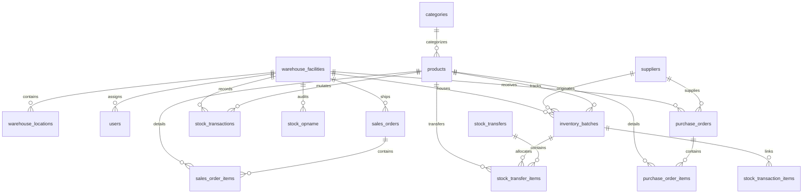

# Dokumentasi Skema Basis Data & Mesin Migrasi SupplySync

Dokumen ini menjelaskan struktur skema basis data relasional MySQL 8.0+, normalisasi tabel, integritas referensial, mesin migrasi terversi (*versioned migrator*), dan mekanisme pencadangan serta pemulihan (*backup and restore*).

---

## 1. Spesifikasi Teknis Basis Data

- **Database Engine**: MySQL 8.0+
- **Storage Engine**: InnoDB (Mendukung ACID Compliance, Foreign Key Constraints, dan Row-Level Locking).
- **Karakter Set & Collation**: `utf8mb4` / `utf8mb4_unicode_ci`
- **Konvensi Penamaan**: `snake_case` untuk tabel dan kolom.

---

## 2. Keputusan Arsitektur Kritis (Architectural Decisions)

### A. Sumber Tunggal Kebenaran Stok (Single Source of Truth)
Dalam evaluasi repository awal, ditemukan inkonsistensi fatal di mana beberapa query mencoba membaca kolom `products.stock` yang tidak ada di schema.
- **Keputusan**: Tabel `inventory_batches` ditetapkan sebagai **satu-satunya sumber kebenaran stok**.
- Jumlah stok fisik dihitung secara agregasi transaksional:
  ```sql
  SELECT COALESCE(SUM(quantity), 0) AS total_stock 
  FROM inventory_batches 
  WHERE product_id = ? AND facility_id = ? AND quantity > 0;
  ```
- Tidak ada redundansi kolom saldo pada master produk yang dapat mengalami desinkronisasi.

### B. Normalisasi Master Kategori
- Kolom teks bebas pada master produk digantikan dengan Foreign Key `category_id` yang merujuk ke tabel `categories(category_id)`.
- Integritas data diamankan dengan constraint `ON DELETE RESTRICT`, mencegah penghapusan kategori yang masih digunakan oleh produk aktif.

### C. Isolasi Multi-Fasilitas (Direct Facility Scoping)
- Kolom `facility_id` disematkan langsung pada tabel operasional: `inventory_batches`, `stock_transactions`, `stock_opname`, `purchase_orders`, `sales_orders`, dan `stock_transfers`.
- Hal ini memungkinkan penguncian baris dan pembagian kuota stok antar-cabang pergudangan tanpa *cross-facility leakage*.

---

## 3. Struktur 16 Tabel Relasional WMS



### Rincian Tabel:
1. **`warehouse_facilities`**: Data master gudang (Pusat, Cabang, Cold Storage).
2. **`warehouse_locations`**: Denah lorong (*aisle*), rak (*rack*), tingkat (*tier*), dan bin simpan.
3. **`users`**: Akun pengguna, peran RBAC (`ADMIN`, `MANAGER`, `STAFF`), hash sandi scrypt, dan penugasan fasilitas.
4. **`categories`**: Klasifikasi produk ternormalisasi.
5. **`suppliers`**: Mitra vendor pemasok lengkap dengan lead time pengiriman.
6. **`products`**: Master katalog SKU barang, satuan, batas minimum stok, dan harga pokok/jual.
7. **`inventory_batches`**: Sumber kebenaran stok. Mencatat kuantitas awal, sisa kuantitas, tanggal penerimaan, tanggal kedaluwarsa, lokasi rak, dan fasilitas.
8. **`stock_transactions`**: Header jejak audit mutasi barang (`IN`, `OUT`, `ADJUSTMENT`, `TRANSFER_IN`, `TRANSFER_OUT`, `DISPOSAL`).
9. **`stock_transaction_items`**: Rincian alokasi kuantitas yang dipotong atau ditambahkan per batch.
10. **`stock_opname`**: Audit fisik rekonsiliasi stok, mencatat stok sistem, fisik, selisih, dan alasan.
11. **`stock_transfers`**: Header transfer antar-gudang dengan status `PENDING`, `IN_TRANSIT`, `COMPLETED`, `CANCELLED`.
12. **`stock_transfer_items`**: Rincian item dan batch yang dikirim antar-fasilitas.
13. **`purchase_orders`**: Dokumen pengadaan barang masuk kepada pemasok.
14. **`purchase_order_items`**: Rincian SKU, kuantitas dipesan, harga satuan, dan kuantitas diterima (GRN).
15. **`sales_orders`**: Dokumen pesanan penjualan barang kepada pelanggan.
16. **`sales_order_items`**: Rincian SKU dan kuantitas penjualan barang keluar.
17. **`schema_migrations`**: Tabel sistem pelacak riwayat migrasi yang telah dieksekusi.

---

## 4. Mesin Migrasi Terversi (Versioned Migration Engine)

Untuk mencegah risiko penghapusan data akibat instruksi destruktif `DROP TABLE`, SupplySync menggunakan mesin migrasi mandiri (`database/migrator.js`):

### Prinsip Operasional:
1. **Pelacakan Eksekusi**: Setiap berkas migrasi dalam direktori `database/migrations/` (format: `001_xxx.sql` hingga `021_xxx.sql`) dicatat ke dalam tabel `schema_migrations` setelah berhasil diterapkan.
2. **Idempotent & Aman**: Migrasi yang telah berstatus `EXECUTED` tidak akan pernah dijalankan ulang.
3. **Tanpa Kehilangan Data**: Inisialisasi normal server menggunakan `CREATE TABLE IF NOT EXISTS`, menjamin data operasional tetap utuh saat aplikasi dinyalakan ulang.

### Perintah Manajemen Database:
```bash
# Menjalankan migrasi tertunda (Pending Migrations)
npm run db:migrate

# Memeriksa status seluruh berkas migrasi
npm run db:migrate:status

# Inisialisasi basis data baru (Non-destructive)
npm run db:init

# Reset total basis data & pasang skema bersih (Khusus Development/Testing Baru)
npm run db:fresh
```

---

## 5. Prosedur Pencadangan & Pemulihan (Backup & Disaster Recovery)

Modul pencadangan (`src/utils/backupService.js`) menjamin ketersediaan data bisnis:

1. **Cakupan Snapshot**:
   - Seluruh 16 tabel WMS dicakup secara lengkap (termasuk Purchase Orders, Sales Orders, dan Stock Transfers).
   - Snapshot SQL Dump dihasilkan dengan escaping aman, transaksi `START TRANSACTION ... COMMIT`, dan penonaktifan sementara `FOREIGN_KEY_CHECKS` selama pemulihan.
2. **Pemulihan Teruji (Restore Procedure)**:
   - File cadangan dieksekusi baris per baris secara transaksional.
   - Jika terjadi kegagalan query di tengah proses, perubahan otomatis dibatalkan (`ROLLBACK`).
3. **Perintah Backup CLI**:
   ```bash
   # Buat snapshot cadangan baru
   npm run db:backup

   # Uji integritas relasi dan saldo stok
   npm run db:verify

   # Pulihkan basis data dari cadangan terbaru
   npm run db:restore
   ```
