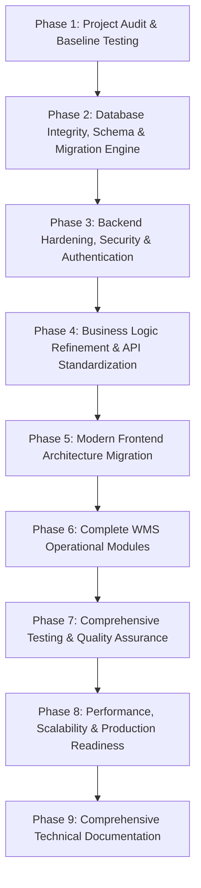

# Implementation Plan: SupplySync Enterprise Warehouse Management System

**Dokumen Rencana Tindak Lanjut & Rekayasa Perangkat Lunak**  
**Target:** Transformasi Enterprise-Grade WMS yang Aman, Andal, Konsisten, dan Teruji  
**Tanggal Penyusunan:** 15 November 2026

---

## 1. Strategi Arsitektur & Prinsip Pengembangan

Pengembangan sistem dibagi menjadi 9 fase berurutan yang saling mendukung (*progressive enhancements*). Setiap fase memiliki cakupan pekerjaan, kriteria keberhasilan (*acceptance criteria*), dan verifikasi pengujian otomatis sebelum melangkah ke fase berikutnya.

### Prinsip Utama:
1. **Zero Data Loss**: Tidak ada operasi destruktif (`DROP TABLE`) pada skema basis data operasional.
2. **Single Source of Truth**: Kuantitas stok mutlak bersumber dari agregasi tabel `inventory_batches`.
3. **Strict RBAC & Facility Scoping**: Otorisasi ditegakkan pada lapisan controller/middleware backend, bukan sekadar manipulasi tampilan antarmuka.
4. **Security by Design**: Autentikasi berbasis JWT aman, penghapusan auto-login demo, penegakan NIST-compliant password hashing, dan mitigasi injection.
5. **Modern Frontend Pipeline**: Migrasi frontend monolitik menuju arsitektur modular **React + Vite + TypeScript + Tailwind CSS** dengan build pipeline lokal berkinerja tinggi.
6. **Per-Feature Git Commit**: Melakukan commit lokal untuk setiap fitur atau pencapaian penting menggunakan git CLI standar.

---

## 2. Peta Fase Implementasi

---

## 3. Rincian Pelaksanaan per Fase

### PHASE 1 — Baseline Testing & Initial Documentation (Selesai)
- [x] Audit komprehensif terhadap seluruh file repository.
- [x] Verifikasi status pengujian awal (129 pass).
- [x] Pembuatan dokumen `docs/PROJECT_AUDIT.md`.
- [x] Pembuatan dokumen `docs/IMPLEMENTATION_PLAN.md`.

---

### PHASE 2 — Database Integrity, Schema & Migration Engine
**Fokus:** Menjamin keamanan data, pelacakan versi database otomatis, dan penormalan relasi.
1. **Migration Runner Terintegrasi**:
   - Bangun runner migrasi otomatis (`database/migrator.js`) dengan tabel `schema_migrations`.
   - Jalankan migrasi berurutan secara transaksional dan idempoten (*safe if re-run*).
2. **Perbaikan Skema Utama**:
   - Hapus perintah destruktif `DROP TABLE IF EXISTS` pada inisialisasi normal (`database/schema.sql`).
   - Buat file instalasi bersih terpisah (`database/schema_fresh.sql`) dan migration scripts.
   - Tambahkan `facility_id` langsung ke tabel `inventory_batches` dengan Foreign Key ke `warehouse_facilities`.
   - Tambahkan relasi `category_id INT` dan Foreign Key pada tabel `products` serta lakukan migrasi data nama kategori yang sudah ada secara mulus.
   - Perbaiki hash pengguna seeder dengan nilai scrypt 64-byte yang valid untuk admin, manager, dan staff.
3. **Penyempurnaan Utilitas Backup & Recovery**:
   - Perbaiki query `verifyDataIntegrity` di `src/utils/backupService.js` agar tidak membaca kolom fiktif `products.stock`.
   - Daftarkan `purchase_orders`, `purchase_order_items`, `sales_orders`, dan `sales_order_items` ke dalam `WMS_TABLES`.
   - Implementasikan fungsi restore database dari file snapshot JSON maupun SQL dump.
   - Sediakan script CLI `npm run db:restore <filename>`.

---

### PHASE 3 — Backend Hardening, Security & Authentication
**Fokus:** Menutup seluruh celah keamanan dan menegakkan akses kontrol peran (RBAC).
1. **Pembersihan Celah Autentikasi**:
   - Hapus total fallback `DEMO_USERS` dan default password testing dari `src/controllers/authController.js`.
   - Perbaiki `verifyPassword` di `src/utils/security.js` agar hanya memvalidasi hash scrypt dengan ukuran buffer yang aman (`timingSafeEqual` yang terlindungi dari `RangeError`).
   - Cegah fallback string `JWT_SECRET` statis di lingkungan produksi.
   - Tambahkan batas kedaluwarsa token dan mekanisme logout token blacklist/revocation.
2. **Penguatan RBAC & Facility Scoping di Seluruh Endpoint**:
   - Pasang middleware `authenticateToken` pada seluruh endpoint data gudang.
   - Pasang `requireFacilityScope` pada seluruh mutasi stok: inbound, outbound, disposal, dan opname.
   - Batasi query pembacaan (list, search, filter, export) agar operator STAFF hanya menerima data fasilitas gudang tempatnya ditugaskan.
3. **Keamanan HTTP & API Proteksi**:
   - Integrasikan `helmet` untuk security headers yang ketat.
   - Terapkan `express-rate-limit` untuk melindungi endpoint autentikasi dari serangan *brute-force*.
   - Standarisasi format respons JSON: `{ status: 'Success'|'Error', message: string, data?: any }`.

---

### PHASE 4 — Business Logic Refinement & API Standardization
**Fokus:** Memastikan proses transaksi gudang bersifat atomik, akurat, dan deterministik.
1. **FEFO Allocation Engine**:
   - Pastikan alokasi FEFO mengunci baris stok menggunakan `SELECT ... FOR UPDATE`.
   - Validasi kedaluwarsa batch secara ketat: batch yang sudah kedaluwarsa ditolak dari pengeluaran penjualan (hanya boleh melalui modul Disposal).
2. **Stock Opname Facility-Aware**:
   - Sesuaikan rekonsiliasi opname agar menghitung stok sistem berdasarkan `facility_id` operator/gudang yang diperiksa.
   - Simpan `facility_id` pada tabel `stock_opname`.
3. **Pengadaan (PO) & Penjualan (SO)**:
   - Hubungkan penerimaan PO langsung ke pembentukan batch dengan input lokasi rak fleksibel dan status penerimaan parsial/penuh yang akurat.
   - Hubungkan pengiriman SO ke modul FEFO otomatis untuk mengurangi stok secara aman dan mencatat Delivery Order.
4. **CRUD Lengkap untuk Master Data**:
   - Lengkapi API `suppliers`: Get By ID, Update, Deactivate/Activate.
   - Lengkapi API `categories`: Get By ID, Update, Delete/Check usage.
   - Lengkapi API `locations`: Get By ID, Update, Deactivate, Filter by Facility.
   - Buat API `users`: Tambah Pengguna, Edit, Ubah Role & Fasilitas, Toggle Aktif, Reset Password.

---

### PHASE 5 — Modern Frontend Architecture Migration (React + Vite + TypeScript)
**Fokus:** Membangun antarmuka kelas enterprise yang modular, responsif, berkinerja tinggi, dan type-safe.
1. **Inisialisasi Proyek Frontend Modern**:
   - Setup folder `frontend` dengan React 18+, Vite, TypeScript, dan Tailwind CSS (lokal pipeline build).
   - Konfigurasi proxy Vite ke backend Express (`http://localhost:5000/api`).
2. **Arsitektur Direktori Frontend**:
   - `src/components/common/`: Tombol, Modal, Input, Badge, Toast, Table, Pagination, Card.
   - `src/components/layout/`: Sidebar, Header, Breadcrumb, PageContainer.
   - `src/pages/`: Login, Dashboard, Inventaris, Transaksi, Transfer, Pesanan, Opname, Lokasi, Pemasok, Kategori, Pengguna, Laporan, Backup.
   - `src/services/`: Modul API axios/fetch terpusat dengan interceptor otentikasi.
   - `src/context/`: AuthContext, FacilityContext.
   - `src/types/`: Definisi interface TypeScript untuk seluruh entitas WMS.
3. **Enterprise UI/UX Standards**:
   - Palet warna: Navy profesional (`#0f172a`, `#1e293b`), Slate neutral, White, Accent status (Emerald, Amber, Rose, Indigo).
   - Penggunaan Bahasa Indonesia baku dan profesional pada seluruh komponen.
   - Server-side / client-side pagination terintegrasi, filter multifasilitas, loading skeleton, dan error state terpusat.
   - Penggantian CDN Tailwind dengan build CSS lokal optimal yang siap di-serve oleh Express saat proses production (`npm run build:frontend`).

---

### PHASE 6 — Complete WMS Operational Modules
**Fokus:** Menuntaskan seluruh fitur operasional pergudangan di lapisan visual & API.
1. **Halaman Login & Manajemen Sesi Nyata**:
   - Form otentikasi aman tanpa auto-login.
   - Tampilan profil pengguna dan fasilitas gudang aktif.
2. **Manajemen Pengguna (User Management UI)**:
   - Daftar staf & manajer, filter role, form penugasan cabang gudang, reset kata sandi, toggle status akun.
3. **Master Pemasok & Kategori UI**:
   - Pengelolaan data pemasok lengkap dengan nomor kontak dan lead time.
   - Pengelolaan kategori produk dan visualisasi jumlah SKU per kategori.
4. **Manajemen Fasilitas & Lokasi Rak**:
   - Peta visual lorong, rak, tier, dan bin per fasilitas gudang.
5. **Pusat Laporan & Ekspor CSV**:
   - Kartu Stok Ledger (Running Balance), Valuasi Inventaris, Mutasi Inbound/Outbound, Kedaluwarsa Batch, dan Ringkasan PO/SO.
   - Ekspor CSV format Excel RFC-4180 terstandarisasi.
6. **Utilitas Backup & Restore UI**:
   - Riwayat cadangan, status kesehatan data (Integrity Score), tombol buat backup, dan prosedur pemulihan (*restore*).

---

### PHASE 7 — Comprehensive Testing & Quality Assurance
**Fokus:** Pengujian menyeluruh pada backend, database, logika konkurensi, dan alur kerja end-to-end.
1. **Backend & Unit Testing**:
   - Perbaiki pengujian lama yang mengasumsikan password demo (`tests/security.test.js`).
   - Uji verifikasi integritas data yang diperbarui tanpa kolom palsu `stock`.
2. **Concurrent Transaction Testing**:
   - Simulasi 2 atau lebih permintaan mutasi keluar simultan terhadap batch yang sama untuk memverifikasi proteksi `SELECT FOR UPDATE` dan pencegahan saldo stok negatif.
3. **Database Migration & Backup Testing**:
   - Uji migrasi beruntun dari skema lama ke skema baru.
   - Uji pencadangan dan pemulihan data (Round-trip Backup & Restore Test).
4. **End-to-End Business Flow Test**:
   - Alur: Login Admin -> Buat Produk -> Buat Pemasok -> Buat PO -> Setujui PO -> Terima Barang (Batch terbentuk) -> Buat SO -> Konfirmasi SO -> Pengiriman (Alokasi FEFO) -> Kartu Stok Terverifikasi -> Stock Opname.

---

### PHASE 8 — Performance, Security & Production Readiness
**Fokus:** Optimasi performa dan kesiapan produksi.
1. Konfigurasi Connection Pool MySQL dan indexing query mutasi.
2. Konfigurasi build pipeline produksi (Vite build ke `public/` atau direktori distribusi yang di-serve Express).
3. Pembersihan `.env.example` dan dokumentasi variabel lingkungan.
4. Setup GitHub Actions CI Workflow untuk automated syntax check & tests.

---

### PHASE 9 — Documentation & Final Review
**Fokus:** Dokumentasi komprehensif bagi developer, administrator, dan pengguna.
- Pembaruan `README.md`.
- `docs/ARCHITECTURE.md`.
- `docs/DATABASE.md`.
- `docs/API_DOCUMENTATION.md`.
- `docs/SECURITY.md`.
- `docs/TESTING.md`.
- `docs/USER_GUIDE.md`.

---

## 4. Jadwal Eksekusi & Git Commit Strategy

Setiap capaian penting diselesaikan secara tuntas dan di-commit ke Git lokal:
1. `docs: audit komprehensif arsitektur repository dan rencana implementasi wms enterprise`
2. `feat(db): migrator berversi, refaktor skema relasional, dan perbaikan integritas backup`
3. `feat(auth): penguatan otentikasi scrypt nist, pembersihan celah keamanan, dan rbac komprehensif`
4. `feat(api): penyempurnaan logika bisnis wms, scoping fasilitas, dan crud master data`
5. `feat(frontend): modernisasi antarmuka react vite typescript dengan tailwind css enterprise`
6. `feat(wms): implementasi modul operasional lengkap user, supplier, kategori, laporan, dan backup ui`
7. `test: penambahan pengujian konkurensi, e2e bisnis pergudangan, dan pembaruan unit test`
8. `chore: optimasi produksi, build pipeline, dan ci workflow`
9. `docs: pembaruan dokumentasi teknis menyeluruh, arsitektur, api, dan panduan pengguna`
